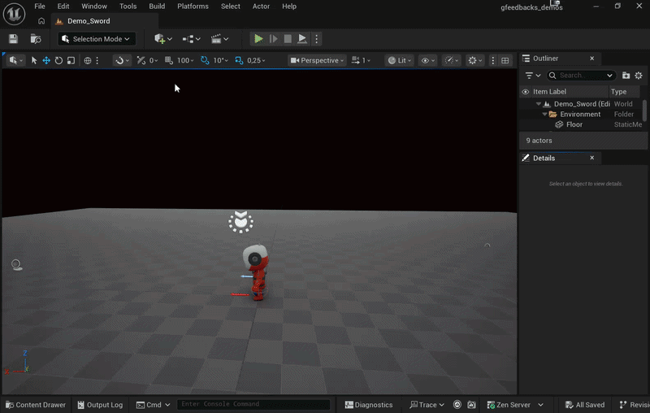
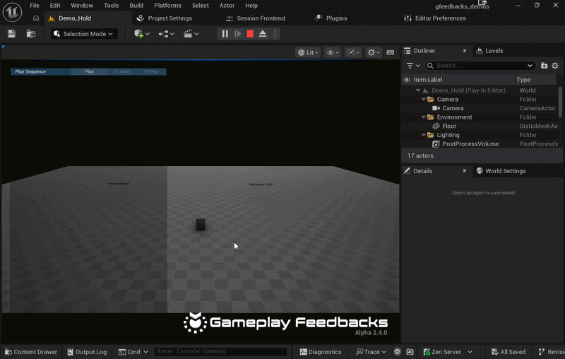

# Gameplay Feedbacks - Demo Project

## Features Demos

This project showcases the possibilities of the **Gameplay Feedbacks** framework. Each demo is designed to highlight specific features and functionalities, allowing users to understand how to implement and customize feedbacks in their own projects. These demos are listed in the following subsections, along with a brief description of their purpose and features.

For a detailed description of each demo, please refer to the [official plugin documentation](https://marcosecchi.github.io/gameplayfeedbacks_docs/#/overview/demo-project).

## Credits

- KayKit models by [Kay Lousberg](https://kaylousberg.com/)
- SpaceAdventures - OnTheShip audio by [GDQuest](https://www.gdquest.com/)
